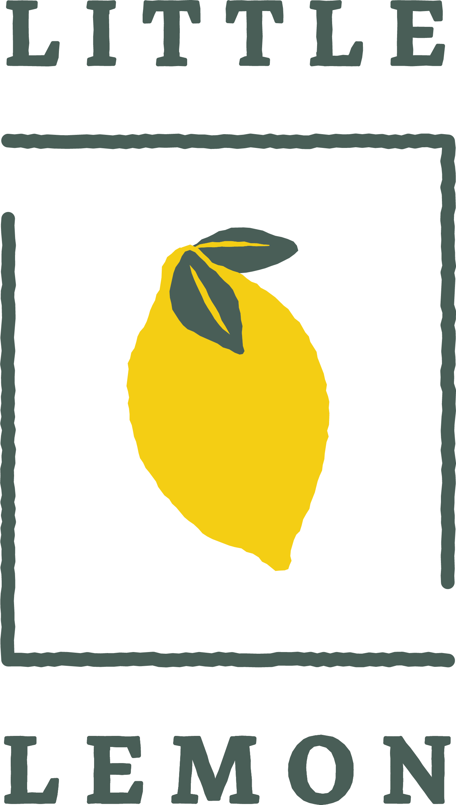
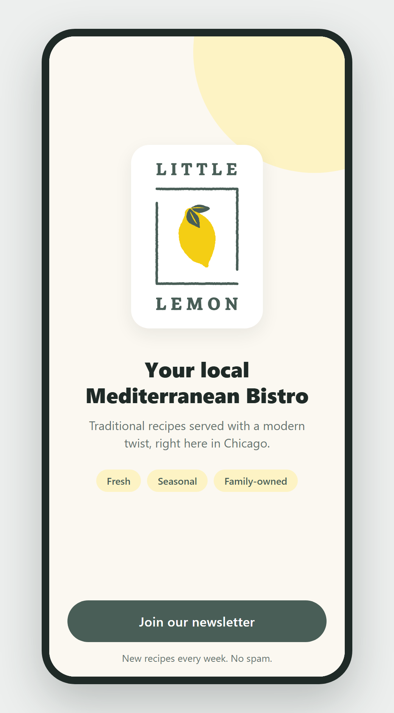
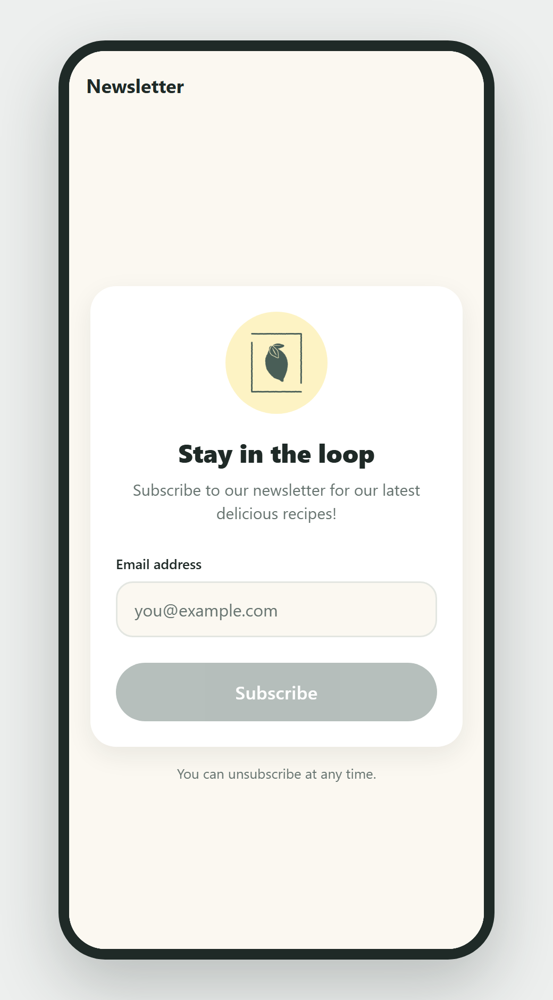

<div align="center">



# Little Lemon

**App móvil para Little Lemon, un bistró mediterráneo de Chicago.**

Proyecto final del curso **React Native** del programa
[Meta React Native Specialization](https://www.coursera.org/specializations/meta-react-native) (Coursera).


</div>

---

## Capturas

<p align="center">
  
  &nbsp;&nbsp;
  
</p>

## Sobre el proyecto

El curso pide una app de dos pantallas: una de **bienvenida** y otra de **suscripción al newsletter** con validación de email. Esta versión cumple los mismos requisitos funcionales que la consigna de Meta, pero con un rediseño visual propio, más moderno y amigable.

### Requisitos del curso

- [x] Pantalla de bienvenida con el logo y el eslogan del restaurante
- [x] Botón que navega a la pantalla del newsletter
- [x] Navegación con un Native Stack de React Navigation
- [x] Campo de email con teclado adecuado y sin autocorrección
- [x] Botón **Subscribe** deshabilitado hasta que el email sea válido
- [x] Alerta de confirmación al suscribirse y limpieza del campo

### Mejoras sobre la consigna original

- **Sistema de diseño**: paleta oficial de Little Lemon (verde `#495E57` y amarillo `#F4CE14`), radios, sombras y colores centralizados en [`constants/theme.js`](constants/theme.js).
- **Componentes reutilizables**: [`PrimaryButton`](components/PrimaryButton.js) con respuesta visual al presionar y estado deshabilitado accesible.
- **Mejor experiencia en el formulario**: etiqueta en el input, borde en foco, mensaje de error al salir del campo, autocompletado de email y envío desde el teclado.
- **Adaptado a cualquier dispositivo**: respeta el área segura (notch, barra de gestos) y el teclado nunca tapa el formulario.
- **Accesibilidad**: roles y estados para lectores de pantalla.
- **Deep linking**: la ruta `/subscribe` abre directamente la pantalla del newsletter.
- **Stack actualizado**: Expo SDK 58, React 19 y React Native 0.88.

## Tecnologías

| | |
|---|---|
| Framework | [Expo](https://expo.dev) SDK 58 · React Native 0.88 · React 19 |
| Navegación | [React Navigation 7](https://reactnavigation.org) (Native Stack) |
| UI | `StyleSheet` de React Native, `react-native-safe-area-context`, `expo-status-bar` |
| Plataformas | Android, iOS y web |

## Estructura

```
.
├── App.js                  # Punto de entrada: providers, navegación y deep links
├── index.js                # Registro del componente raíz
├── navigators/
│   └── RootNavigator.js    # Stack de pantallas y estilo del header
├── screens/
│   ├── WelcomeScreen.js    # Pantalla de bienvenida
│   └── SubscribeScreen.js  # Formulario del newsletter
├── components/
│   └── PrimaryButton.js    # Botón principal reutilizable
├── constants/
│   └── theme.js            # Colores, radios y sombras
├── utils/
│   └── index.js            # Validación de email
└── assets/images/          # Logos, ícono y splash
```

## Cómo correrlo

**Requisitos:** Node.js 20 o superior y la app [Expo Go](https://expo.dev/go) (SDK 58) en el celular, o un emulador Android / simulador iOS.

```bash
git clone https://github.com/antoninojoaquin/LittleLemonApp.git
cd LittleLemonApp
npm install
npx expo start
```

Después escaneá el QR con Expo Go (Android) o con la cámara (iOS). También podés apretar `a` para Android, `i` para iOS o `w` para web.

### Scripts

| Comando | Descripción |
|---|---|
| `npm start` | Inicia el servidor de desarrollo |
| `npm run android` | Abre la app en Android |
| `npm run ios` | Abre la app en iOS |
| `npm run web` | Abre la app en el navegador |

## Créditos

- Consigna, marca y assets de **Little Lemon**: Meta, para la [Meta React Native Specialization](https://www.coursera.org/specializations/meta-react-native).
- Rediseño e implementación: [Joaquín Antonino](https://github.com/antoninojoaquin).

## Licencia

El código está bajo la licencia [MIT](LICENSE). La marca, los logos y los assets de Little Lemon pertenecen a Meta y se usan solo con fines educativos.
